# UAPPKit

SDK Swift para adicionar telas nativas do UAPP a aplicativos Apple: Sobre,
Desenvolvedor, Changelog, Reviews, Feedback, Roadmap e Conta/Perfil. A
interface é SwiftUI, acompanha o tema e o idioma do aplicativo e não incorpora
conteúdo em WebView.

<p align="center">
  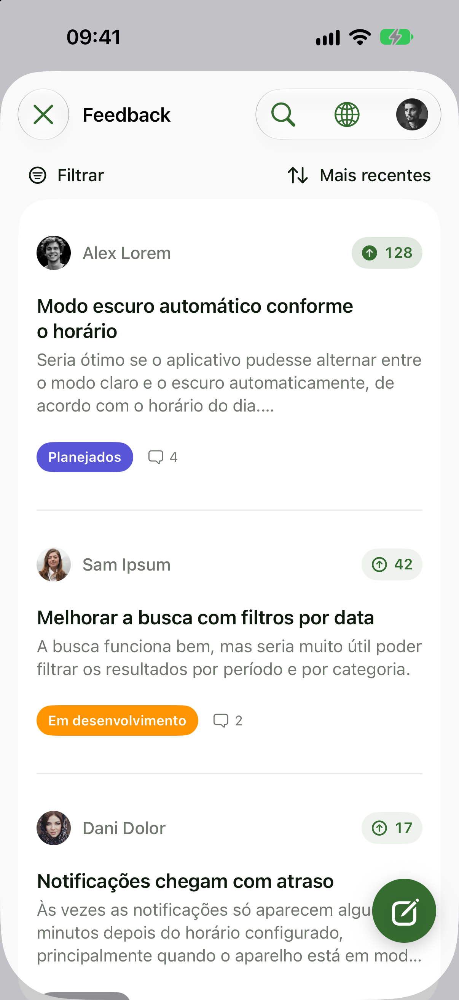
  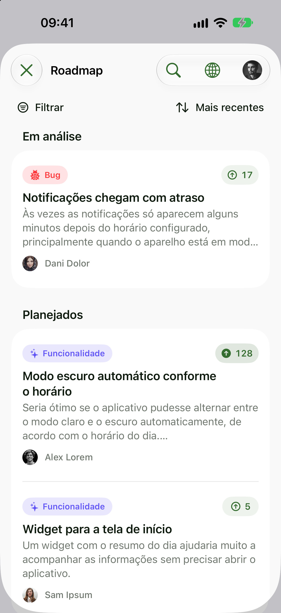
  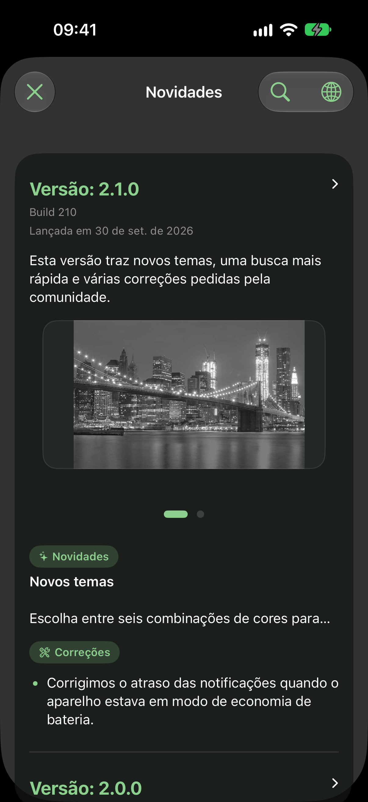
</p>

## Sumário

- [Requisitos](#requisitos)
- [Instalação](#instalação)
- [Setup](#setup)
- [Telas prontas](#telas-prontas)
  - [Sobre](#sobre)
  - [Desenvolvedor](#desenvolvedor)
  - [Changelog](#changelog)
  - [Reviews](#reviews)
  - [Feedback](#feedback)
  - [Roadmap](#roadmap)
  - [Conta e Perfil](#conta-e-perfil)
- [Autenticação](#autenticação)
- [Cliente para interface própria](#cliente-para-interface-própria)
- [Idioma e tradução](#idioma-e-tradução)
- [Tema](#tema)
- [Componentes auxiliares](#componentes-auxiliares)
- [Segurança e privacidade](#segurança-e-privacidade)
- [Documentação](#documentação)
- [Desenvolvimento](#desenvolvimento)

## Requisitos

- Swift 6.0 ou posterior.
- iOS 18 ou posterior, incluindo iPadOS.
- macOS 13 ou posterior para o cliente e as views SwiftUI.

O pacote não declara suporte a watchOS, tvOS ou visionOS. No iOS, o recorte da
foto de perfil usa a biblioteca Mantis, resolvida automaticamente pelo Swift
Package Manager.

## Instalação

No Xcode, escolha **File → Add Package Dependencies…** e informe:

```text
https://github.com/rfcbf/UAPPKit
```

Até a primeira release versionada, selecione a branch `main` e adicione o
produto `UAPPKit` ao target do aplicativo. Em outro `Package.swift`:

```swift
dependencies: [
    .package(url: "https://github.com/rfcbf/UAPPKit", branch: "main")
],
targets: [
    .target(name: "MeuApp", dependencies: ["UAPPKit"])
]
```

Quando a release `0.1.0` for publicada, será possível trocar por
`.package(url: "https://github.com/rfcbf/UAPPKit", from: "0.1.0")`.

## Setup

Chame `UAPPKit.setup` uma vez, na inicialização do aplicativo:

```swift
import SwiftUI
import UAPPKit

@main
struct ExampleApp: App {
    init() {
        UAPPKit.setup(projectId: "meu-app")
    }

    var body: some Scene {
        WindowGroup {
            ContentView()
        }
    }
}
```

Todos os parâmetros além de `projectId` são opcionais:

```swift
UAPPKit.setup(
    projectId: "meu-app",
    host: URL(string: "https://api.exemplo.com")!,
    theme: .system,
    signatureProvider: nil,
    locale: Locale(identifier: "pt-BR")
)
```

| Parâmetro | Padrão | Descrição |
| --- | --- | --- |
| `projectId` | obrigatório | Identificador público do projeto (`public_slug`) configurado no UAPP. |
| `host` | `UAPPConfiguration.defaultHost` | Endereço do serviço UAPP. Informe somente ao usar outro ambiente. |
| `theme` | `.system` | Paleta das telas do kit. Veja [Tema](#tema). |
| `signatureProvider` | `nil` | Closure assíncrona que retorna uma assinatura emitida pelo seu servidor. |
| `locale` | idioma do app/sistema | Idioma inicial das telas. Veja [Idioma e tradução](#idioma-e-tradução). |

O setup não inicia login nem acessa a autenticação. Antes dele, as APIs do kit
lançam `UAPPKitError.notConfigured`.

## Telas prontas

No iOS, os métodos `UAPPKit.show…` apresentam a tela como sheet a partir do
view controller ativo. Em macOS, ou para usar a navegação do próprio
aplicativo, incorpore a view SwiftUI correspondente.

| Tela | Apresentação pelo kit (iOS) | View SwiftUI |
| --- | --- | --- |
| Sobre | `UAPPKit.showAbout(configuration:)` | `UAPPAboutScreen` |
| Desenvolvedor | `UAPPKit.showDeveloperAbout()` | `UAPPDeveloperAboutScreen` |
| Changelog | `UAPPKit.showChangelog(configuration:)` | `UAPPFeedbackScreen(mode: .changelog)` |
| Reviews | `UAPPKit.showReviews(pageSize:)` | `UAPPReviewsScreen` |
| Feedback | `UAPPKit.showFeedback()` | `UAPPFeedbackScreen(mode: .feedback)` |
| Roadmap | `UAPPKit.showRoadmap()` | `UAPPRoadmapScreen` |
| Conta | `UAPPKit.showAuthentication(authentication:)` | `UAPPAccountScreen` |
| Perfil | `UAPPKit.showUser(session:authentication:)` | `UAPPUserScreen` |

Sobre, Desenvolvedor, Changelog e Reviews são públicas e não usam sessão.
Feedback e Roadmap pedem login somente quando a pessoa participa.

### Sobre

<p>
  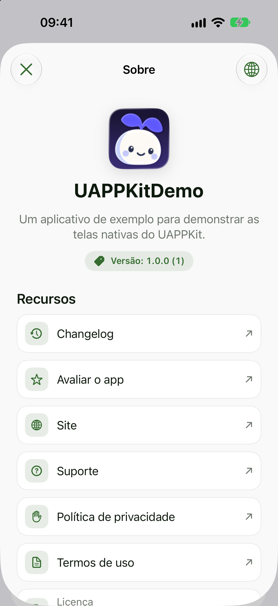
  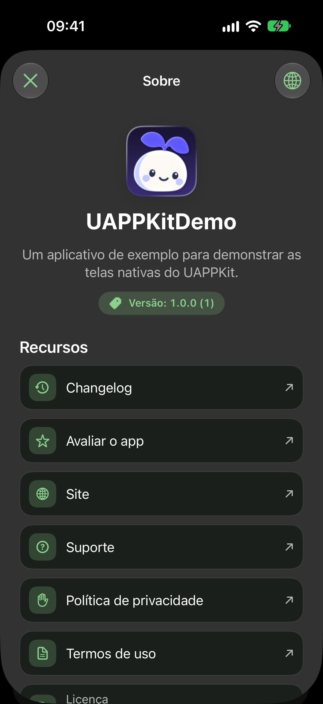
</p>

Apresenta o aplicativo hospedeiro: ícone, nome e versão são descobertos
automaticamente. Descrição, links institucionais e licença são parâmetros.

```swift
try UAPPKit.showAbout(configuration: UAPPAboutConfiguration(
    shortDescription: "Uma descrição curta do aplicativo",
    descriptionLanguageIdentifier: "pt-BR",
    websiteURL: URL(string: "https://exemplo.com"),
    supportURL: URL(string: "mailto:suporte@exemplo.com"),
    privacyPolicyURL: URL(string: "https://exemplo.com/privacidade"),
    termsOfUseURL: URL(string: "https://exemplo.com/termos"),
    license: "MIT",
    showsChangelog: true,
    showsAppStoreReview: true,
    changelogConfiguration: .init(automaticallyScrolls: true, interval: 5, pageSize: 10)
))
```

- `showsChangelog: true` adiciona a ação que abre o Changelog do projeto,
  usando `changelogConfiguration`.
- `showsAppStoreReview: true` adiciona a ação para avaliar o app na App Store.
- A descrição é traduzida sob demanda para o idioma escolhido na tela quando a
  Translation framework está disponível; caso contrário, o original é mantido.

Para abrir a avaliação na App Store a partir da sua própria interface:

```swift
Task {
    try? await UAPPKit.openAppStoreReview()
}
```

### Desenvolvedor

<p>
  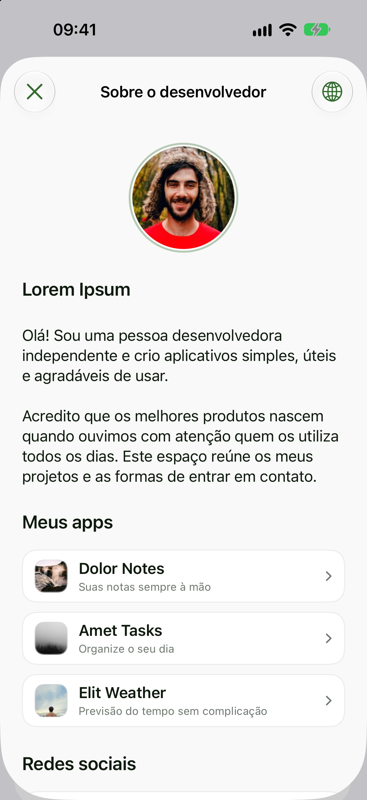
  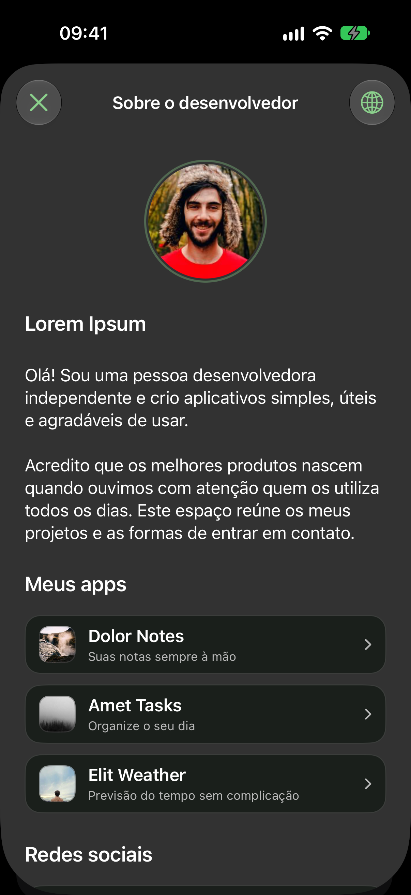
</p>

Mostra o perfil público do desenvolvedor, outros aplicativos e redes sociais
configurados no UAPP. É uma tela separada do Sobre do aplicativo.

```swift
try UAPPKit.showDeveloperAbout()

// Ou na navegação do aplicativo:
UAPPDeveloperAboutScreen(client: try UAPPKit.makeClient())
```

Migração: chamadas antigas a `UAPPAboutScreen(client:)` devem usar
`UAPPDeveloperAboutScreen(client:)`. `UAPPAboutScreen` representa
exclusivamente o aplicativo hospedeiro.

### Changelog

<p>
  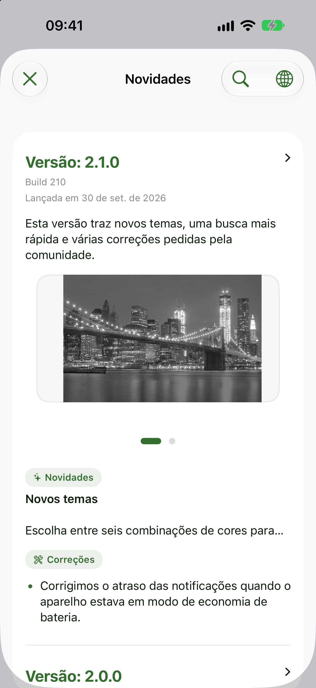
  
</p>

Lista as versões publicadas, com imagens por item, carrossel com reprodução
automática opcional, pesquisa nas versões carregadas e detalhes completos.

```swift
try UAPPKit.showChangelog()

try UAPPKit.showChangelog(
    configuration: UAPPChangelogConfiguration(
        automaticallyScrolls: true,
        interval: 5,
        pageSize: 10
    )
)

// Ou na navegação do aplicativo:
NavigationStack {
    UAPPFeedbackScreen(
        client: try UAPPKit.makeClient(),
        mode: .changelog,
        changelogConfiguration: .init(pageSize: 20)
    )
}
```

`pageSize` é ajustado à faixa de 1 a 50 aceita pela API. Sem configuração, a
reprodução é manual. Veja [configuração e compatibilidade](Documentation/Changelog.md).

### Reviews

<p>
  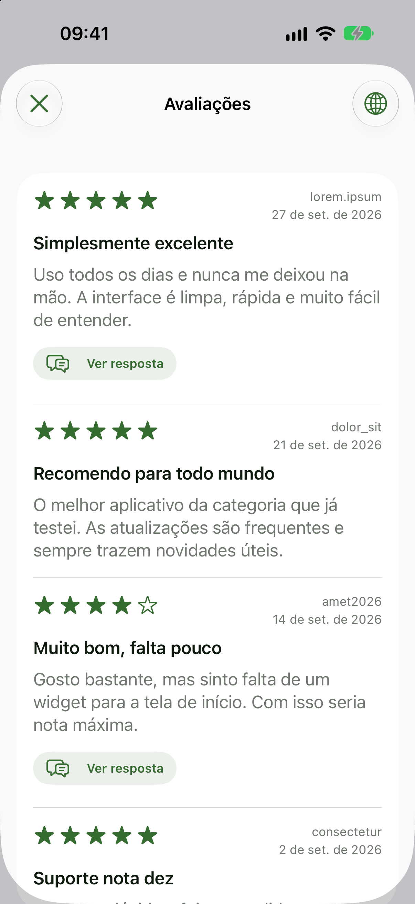
  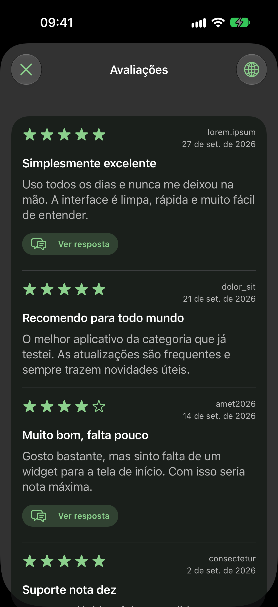
</p>

Apresenta as avaliações da App Store sincronizadas e tornadas públicas no
UAPP, com paginação conforme a rolagem e respostas do desenvolvedor
expansíveis.

```swift
try UAPPKit.showReviews(pageSize: 20)

// Ou na navegação do aplicativo:
UAPPReviewsScreen(client: try UAPPKit.makeClient(), pageSize: 20)
```

`pageSize` é obrigatório e ajustado à faixa de 1 a 50. No iOS 18+ e macOS 15+,
título, texto e resposta são traduzidos para o idioma escolhido; se a tradução
falhar, o conteúdo original é preservado. Veja o
[contrato de reviews](Documentation/Reviews.md).

### Feedback

<p>
  
  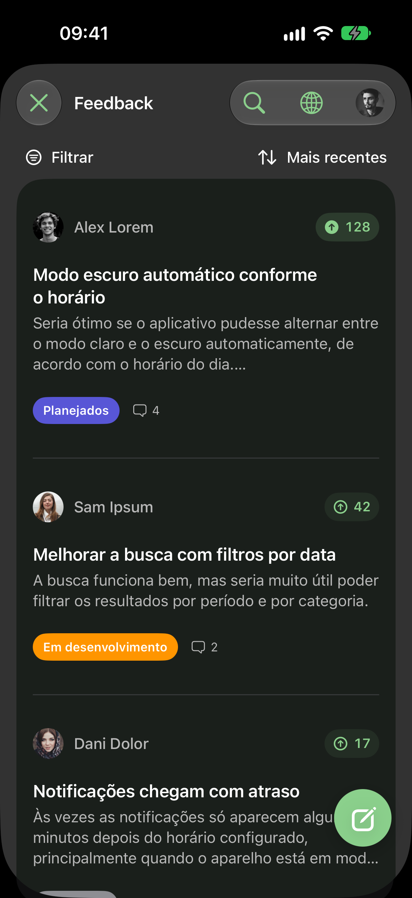
  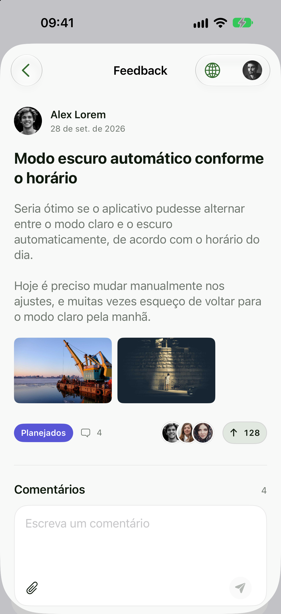
</p>

Lista os feedbacks públicos e permite enviar sugestões, votar e comentar. O
detalhe mostra autor e data, descrição completa, status, votantes e a conversa
com respostas e reações. Feedbacks e comentários aceitam imagens, e a conversa
é atualizada enquanto a tela está ativa.

```swift
try UAPPKit.showFeedback()

// Ou na navegação do aplicativo:
NavigationStack {
    UAPPFeedbackScreen(client: try UAPPKit.makeParticipationClient(), mode: .feedback)
}
```

Sem nenhuma configuração adicional, o kit oferece login por código enviado
por e-mail apenas no momento de participar. Para reutilizar a conta do
aplicativo, veja [Autenticação](#autenticação) e
[Feedback e autenticação](Documentation/Feedback.md).

### Roadmap

<p>
  
  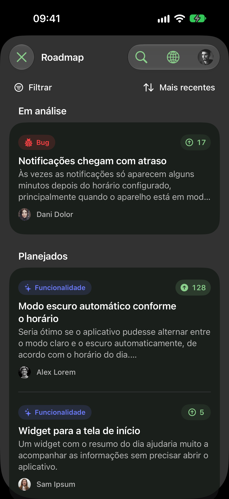
</p>

Organiza os itens públicos por status, com os mesmos detalhes, votos e
comentários do Feedback.

```swift
try UAPPKit.showRoadmap()

// Ou na navegação do aplicativo:
NavigationStack {
    UAPPRoadmapScreen(client: try UAPPKit.makeParticipationClient())
}
```

`UAPPFeedbackScreen(client:mode: .roadmap)` continua disponível e apresenta a
mesma `UAPPRoadmapScreen`.

### Conta e Perfil

<p>
  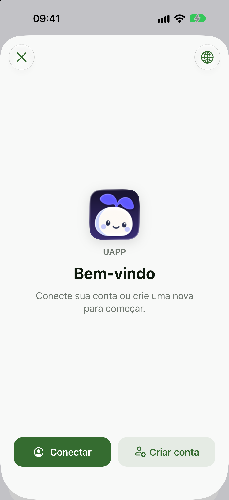
  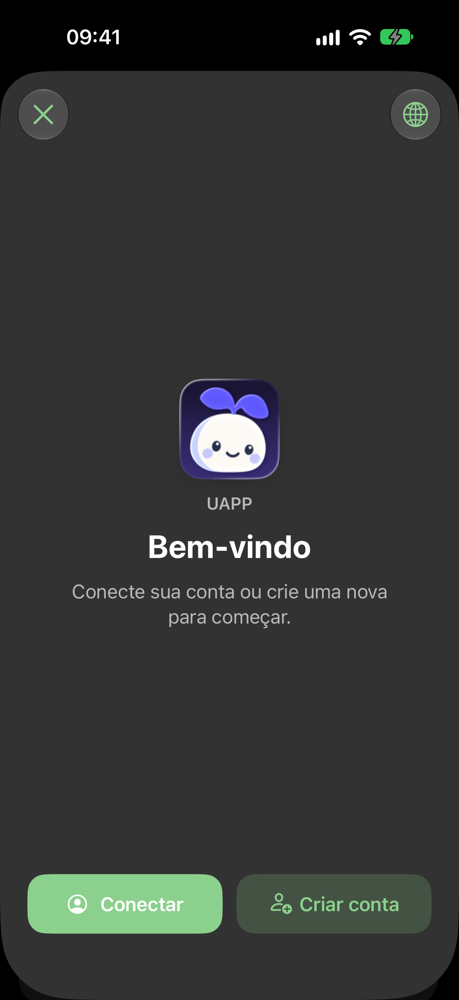
</p>

`UAPPAccountScreen` reúne login por e-mail e senha, Google, Apple e GitHub,
criação de conta com confirmação de e-mail e recuperação de senha, com o ícone
e o tema do aplicativo.

```swift
let authentication = try UAPPKit.makeAuthentication(
    callbackURL: URL(string: "meuapp://authentication")!
)

try UAPPKit.showAuthentication(authentication: authentication) { session in
    // `session` é nil quando a pessoa sai da conta.
    accountModel.session = session
}
```

Em SwiftUI:

```swift
.sheet(isPresented: $showsAccount) {
    UAPPAccountScreen(
        authentication: authentication,
        client: try? UAPPKit.makeClient(),
        minimumPasswordLength: 8,
        termsURL: URL(string: "https://exemplo.com/termos"),
        privacyURL: URL(string: "https://exemplo.com/privacidade"),
        onSessionChange: { accountModel.session = $0 }
    )
}
```

<p>
  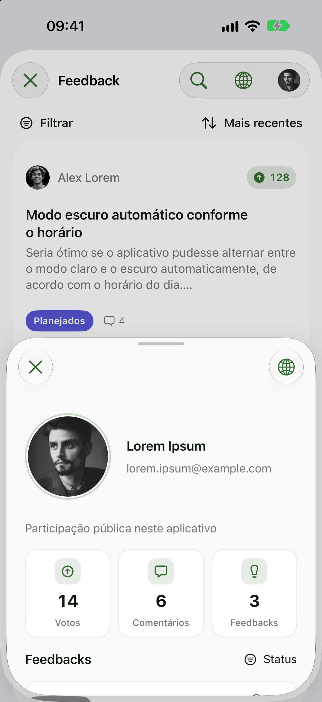
  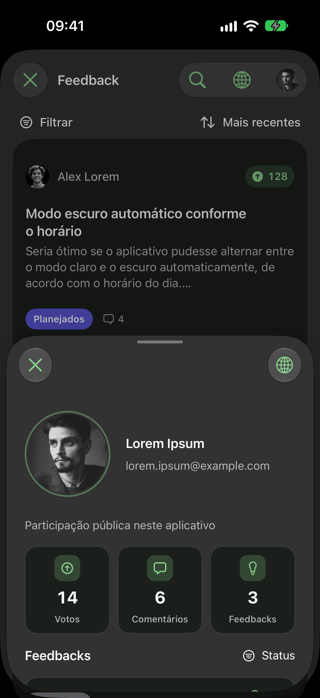
</p>

`UAPPUserScreen` mostra foto, nome e e-mail da conta conectada, a ação de
sair e o histórico de participação em todos os aplicativos vinculados ao mesmo
usuário.

```swift
try UAPPKit.showUser(
    session: session,
    authentication: authentication,
    onSessionChange: { accountModel.session = $0 }
)

// Ou em uma sheet do aplicativo:
UAPPUserScreen(
    session: session,
    authentication: authentication,
    client: try? UAPPKit.makeClient(),
    onSessionChange: { accountModel.session = $0 }
)
```

Veja [conta e participação global](Documentation/UserActivity.md) e
[fotos de perfil](Documentation/ProfilePhotos.md).

## Autenticação

Somente Feedback, Roadmap, Conta e Perfil usam sessão. Há três formas de
integrar, da mais simples à mais controlada.

### 1. Automática

Nada a configurar. `UAPPKit.showFeedback()`, `UAPPKit.showRoadmap()` e
`UAPPKit.makeParticipationClient()` oferecem login por código enviado por
e-mail somente quando a pessoa vota, comenta ou envia um feedback. A sessão
fica no Keychain do aplicativo.

### 2. Provedor do kit

Use quando o aplicativo quer uma conta visível, com Apple, Google, GitHub e
e-mail. Crie o provedor depois do setup e mantenha a mesma instância na camada
de conta:

```swift
let authentication = try UAPPKit.makeAuthentication(
    callbackURL: URL(string: "meuapp://authentication")!,
    methods: [.apple, .google, .email]
)

// Ao abrir o aplicativo, restaure a sessão salva.
let session = try await authentication.currentSession()

// Reutilize a conta em Feedback e Roadmap.
try await UAPPKit.showFeedback(authentication: authentication)
try await UAPPKit.showRoadmap(authentication: authentication)

// Sair pela interface do aplicativo.
try await authentication.signOut()
```

O provedor salva perfil, tokens e expiração no Keychain, separados por
servidor e projeto, e renova tokens expirados. Senhas não são armazenadas.
`currentSession()` é assíncrona: aguarde a restauração antes de decidir entre
mostrar a conta ou a opção de login. Uma falha temporária de rede não apaga a
sessão salva.

Para o login com Google, Apple e GitHub retornar ao aplicativo, registre o
esquema de `callbackURL` no target:

1. No Xcode, selecione o target do aplicativo e abra **Info → URL Types**.
2. Em **URL Schemes**, informe o esquema sem `://` (por exemplo, `meuapp`).
3. Use o endereço completo (`meuapp://authentication`) em `callbackURL`.

A habilitação do endereço de retorno no serviço de autenticação é feita pela
equipe responsável pelo UAPP; informe o endereço adotado para habilitação.

### 3. `UAPPAuthenticationProvider` próprio

Use quando o aplicativo já tem login e sessão. Implemente o protocolo como um
adaptador da sua camada de conta. Apenas quatro membros são obrigatórios; os
demais têm implementação padrão que lança
`UAPPAuthenticationError.unsupportedMethod`.

```swift
struct AppAuthentication: UAPPAuthenticationProvider {
    let account: AccountService

    var methods: [UAPPLoginMethod] { [.email] }

    func currentSession() async throws -> UAPPAuthenticationSession? {
        guard let user = await account.currentUser() else { return nil }
        return UAPPAuthenticationSession(
            identity: UAPPIdentity(
                userId: user.id,
                email: user.email,
                displayName: user.name
            ),
            accessToken: try await account.accessToken()
        )
    }

    func signIn(method: UAPPLoginMethod) async throws -> UAPPAuthenticationSession {
        try await account.presentLogin()
        guard let session = try await currentSession() else {
            throw UAPPAuthenticationError.cancelled
        }
        return session
    }

    func signOut() async throws {
        try await account.signOut()
    }
}

try await UAPPKit.showFeedback(authentication: AppAuthentication(account: account))
```

Com um provedor próprio, persistência e restauração da sessão são
responsabilidade dele. O backend valida o token em cada operação.

Se o aplicativo só precisa fornecer um token, sem fluxo de login pelo kit:

```swift
try await UAPPKit.showFeedback(
    identity: UAPPIdentity(userId: "user-123", displayName: "Pessoa"),
    accessTokenProvider: { try await account.accessToken() }
)
```

### Identidade opcional

`identify` associa ações a um usuário final informado pelo aplicativo. Não
cria nem autentica uma conta.

```swift
UAPPKit.identify(
    userId: "user-123",
    email: "pessoa@example.com",
    displayName: "Pessoa"
)

// Ao encerrar a sessão do usuário:
UAPPKit.reset()
```

`signatureProvider`, no setup, envia uma assinatura obtida no seu servidor no
header `x-uapp-signature`. O backend atual ainda não valida esse valor;
portanto, ele não deve ser tratado como controle de autorização ativo.

Fluxos completos e limitações em
[Autenticação reutilizável](Documentation/Authentication.md) e
[Feedback e autenticação](Documentation/Feedback.md).

## Cliente para interface própria

`UAPPClient` é um `actor` com métodos assíncronos, para montar a interface do
próprio aplicativo sem as telas do kit.

```swift
let client = try UAPPKit.makeClient()

// Leitura
let feedbackPage = try await client.feedbackPage(limit: 20)
let nextPage = try await client.feedbackPage(limit: 20, cursor: feedbackPage.nextCursor)
let columns = try await client.roadmap()
let entries = try await client.changelog()
let releases = try await client.changelogPage(
    limit: 20,
    filters: UAPPChangelogFilters(
        category: .security,
        platform: .ios,
        from: "2026-01-01",
        to: "2026-12-31"
    )
)
let comments = try await client.comments(itemId: "feedback-id")
```

Para escrever, use um cliente com participação: o automático
(`makeParticipationClient()`) ou um criado com a sua autenticação.

```swift
let client = try await UAPPKit.makeClient(authentication: authentication)

let submittedId = try await client.submitFeedback(
    title: "Melhorar o fluxo de login",
    body: "Seria útil manter a sessão ativa.",
    category: .improvement
)

try await client.setReaction(itemId: "feedback-id", kind: .vote, enabled: true)

try await client.submitComment(
    itemId: "feedback-id",
    body: "Também seria útil para mim."
)

let activity = try await client.userActivity(session: session, limit: 20)
```

- Páginas de feedback, comentários e changelog incluem `nextCursor`.
- `submitFeedback` e `submitComment` aceitam `imagesData:` com até duas
  imagens compactadas, de no máximo 512 KiB cada.
- Reações valem para feedbacks e, com `commentId:`, para comentários.
- Comentários enviados entram em moderação.
- Erros chegam como `UAPPKitError` (`notConfigured`, `http`, `invalidResponse`,
  `transport`) ou `UAPPAuthenticationError`.

O transporte é injetável. O padrão, `URLSessionTransport`, cancela a
requisição se a resposta não chegar em 15 segundos; o prazo pode ser ajustado
com `URLSessionTransport(session:timeoutInterval:)`. Para testes ou rede
própria, implemente `UAPPTransport`:

```swift
let client = UAPPClient(
    configuration: UAPPConfiguration(projectId: "meu-app"),
    transport: MeuTransporte()
)
```

## Idioma e tradução

<p>
  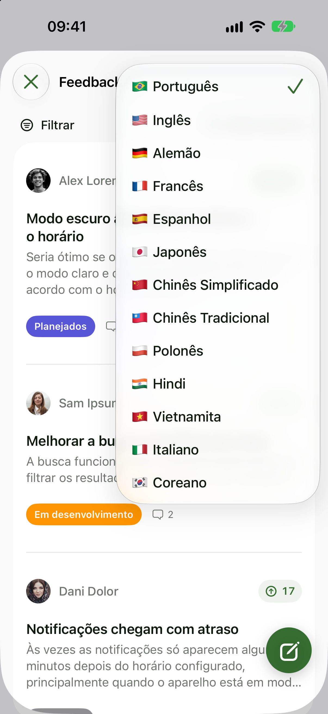
</p>

Os textos do kit ficam em um String Catalog e começam no idioma do aplicativo
hospedeiro. Sem um idioma informado, o SDK usa o idioma do sistema e volta
para Português (Brasil) quando ele não está disponível.

```swift
// Idioma inicial explícito.
UAPPKit.setup(projectId: "meu-app", locale: Locale(identifier: "en"))

// Alterar depois, por exemplo a partir dos ajustes do aplicativo.
UAPPKit.setLocale(Locale(identifier: "de"))

// Idiomas disponíveis, para montar um seletor próprio.
let languages = UAPPLanguage.supported
```

Idiomas disponíveis: Português (Brasil), Inglês, Alemão, Francês, Espanhol,
Japonês, Chinês Simplificado, Chinês Tradicional, Polonês, Hindi, Vietnamita,
Italiano e Coreano.

Todas as telas exibem um seletor próprio de idioma. Cada apresentação começa
no idioma do aplicativo, e uma troca feita dentro da tela vale apenas para
aquela apresentação, sem alterar o aplicativo por trás.
`UAPPKit.localePreferenceKey` é a chave de `UserDefaults` que uma tela própria
pode observar para acompanhar a seleção persistida.

O conteúdo vindo do serviço (descrição do Sobre, changelog, reviews e
feedbacks) é traduzido no dispositivo com a Translation framework da Apple
quando disponível (iOS 18+ e macOS 15+). Se a tradução não estiver disponível
ou falhar, o texto original é mantido.

## Tema

O tema é definido uma vez no setup e vale para todas as telas.

- **Sistema** (`.system`, padrão): cores semânticas da Apple, acompanhando
  automaticamente os modos claro e escuro.
- **Personalizado**: paletas independentes para claro e escuro. Cores omitidas
  continuam usando os valores dinâmicos do sistema.

```swift
UAPPKit.setup(
    projectId: "meu-app",
    theme: UAPPTheme(
        light: .init(
            background: Color(red: 0.96, green: 0.95, blue: 1),
            cardBackground: .white,
            primaryText: Color(red: 0.12, green: 0.10, blue: 0.20),
            secondaryText: .secondary,
            accent: Color(red: 0.36, green: 0.30, blue: 0.96),
            buttonText: .white
        ),
        dark: .init(
            background: Color(red: 0.08, green: 0.07, blue: 0.12),
            cardBackground: Color(red: 0.14, green: 0.13, blue: 0.19),
            primaryText: .white,
            secondaryText: Color.white.opacity(0.68),
            accent: Color(red: 0.56, green: 0.51, blue: 1),
            buttonText: Color(red: 0.08, green: 0.07, blue: 0.12)
        )
    )
)
```

As cores personalizáveis são `background`, `cardBackground`, `primaryText`,
`secondaryText`, `accent`, `buttonText` e `separator`. `buttonText` controla o
texto em botões preenchidos e, por padrão, é branco. Sem `accent`, o kit usa a
cor pública configurada para o aplicativo no UAPP e, antes de recebê-la, a cor
de destaque do sistema.

O kit não tem um parâmetro para fixar claro ou escuro: as telas acompanham a
aparência ativa. Para fixar um modo em uma view incorporada, use o modificador
do SwiftUI:

```swift
UAPPReviewsScreen(client: client, pageSize: 20)
    .preferredColorScheme(.dark)
```

## Componentes auxiliares

### Imagens com cache

As telas do kit compartilham um cache de imagens remotas, que também pode ser
usado pelo aplicativo:

```swift
UAPPCachedImage(url: avatarURL) { phase in
    if let image = phase.image {
        image.resizable().scaledToFill()
    } else if avatarURL == nil || phase.error != nil {
        Image(systemName: "person.crop.circle.fill")
            .resizable().scaledToFit()
    } else {
        UAPPImageLoadingPlaceholder()
    }
}
.frame(width: 64, height: 64)
.clipShape(Circle())
```

O cache em memória tem limite de 32 MB e 100 entradas, com validade de até
cinco minutos, respeitando `Cache-Control` e `Age`. O cache HTTP em disco tem
limite de 64 MB. Requisições simultâneas da mesma URL compartilham o download;
imagens são decodificadas em até 2048 pixels e respostas acima de 10 MB são
rejeitadas. `UAPPImageCache.removeAll()`, na main actor, limpa memória e disco
e cancela downloads pendentes.

### Foto de perfil

No iOS, `UAPPProfilePhotoPicker(photo: $photo)` permite escolher uma imagem da
biblioteca ou da câmera, ajustar o recorte circular e receber um JPEG
comprimido de até 512 pixels.

A câmera exige `NSCameraUsageDescription` no Info.plist **do aplicativo**; o
pacote não adiciona essa chave. No Xcode, selecione o target do aplicativo,
abra **Info** e adicione **Privacy - Camera Usage Description**, ou edite o
Info.plist:

```xml
<key>NSCameraUsageDescription</key>
<string>A câmera permite tirar uma foto para o seu perfil.</string>
```

Sem essa descrição, o seletor informa que a câmera está indisponível. A
biblioteca usa `PhotosPicker` e não exige `NSPhotoLibraryUsageDescription`.
Veja [uso e configuração](Documentation/ProfilePhotos.md).

## Segurança e privacidade

- `projectId` e `host` identificam o projeto e não são segredos.
- Não coloque chaves administrativas, segredos de backend, tokens APNs ou
  credenciais Apple no aplicativo.
- As operações usam endpoints públicos do UAPP, que retornam somente conteúdo
  público. O backend aplica publicação, visibilidade, moderação e limites de
  envio.
- O SDK cria e persiste um UUID de instalação por projeto em `UserDefaults`
  para identificar reações e dar suporte a chaves de idempotência.
- Sessões ficam no Keychain do aplicativo; senhas não são armazenadas.
- `identify` envia os dados opcionais informados pelo aplicativo em ações de
  feedback. Use-o conforme a política de privacidade e o consentimento do seu
  aplicativo.

## Documentação

| Documento | Conteúdo |
| --- | --- |
| [Architecture.md](Documentation/Architecture.md) | Arquitetura do pacote e contrato HTTP. |
| [Authentication.md](Documentation/Authentication.md) | Conta, login, cadastro e persistência da sessão. |
| [Feedback.md](Documentation/Feedback.md) | Feedback, Roadmap e participação autenticada. |
| [Changelog.md](Documentation/Changelog.md) | Configuração e compatibilidade do Changelog. |
| [Reviews.md](Documentation/Reviews.md) | Contrato e paginação das avaliações. |
| [UserActivity.md](Documentation/UserActivity.md) | Perfil e participação global da conta. |
| [ProfilePhotos.md](Documentation/ProfilePhotos.md) | Seleção, recorte e envio da foto de perfil. |
| [Decisions.md](Documentation/Decisions.md) | Decisões de projeto. |
| [Roadmap.md](Documentation/Roadmap.md) | Checklist de implementação das telas. |
| [CHANGELOG.md](CHANGELOG.md) | Alterações por versão. |

## Desenvolvimento

```sh
swift package dump-package
swift build
swift build -c release
swift test
swiftformat . --lint
swiftlint lint --strict
```

As ferramentas podem ser instaladas com
`brew install swiftformat swiftlint xcodegen`.

O app de demonstração fica em [`.Examples/UAPPKitDemo`](.Examples/UAPPKitDemo/README.md),
em um diretório oculto para não aparecer na árvore da dependência local no
Xcode. Para gerar o projeto, entre nesse diretório e execute
`xcodegen generate`.

As capturas de tela deste README ficam em
[`Documentation/Images`](Documentation/Images/README.md). Consulte
[`AGENTS.md`](AGENTS.md) para as instruções de contribuição.
